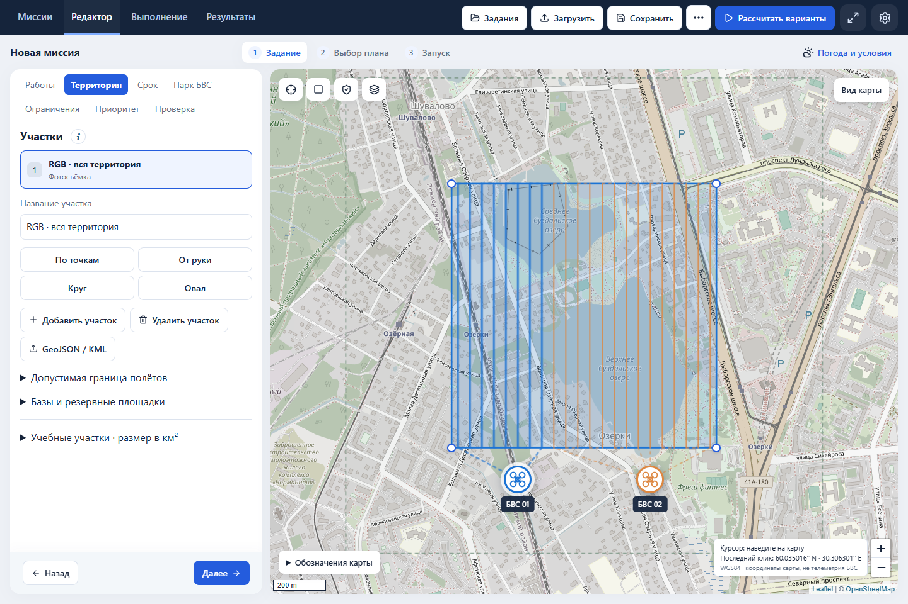
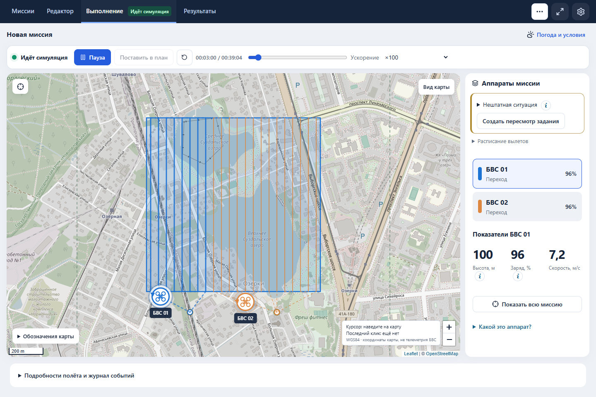
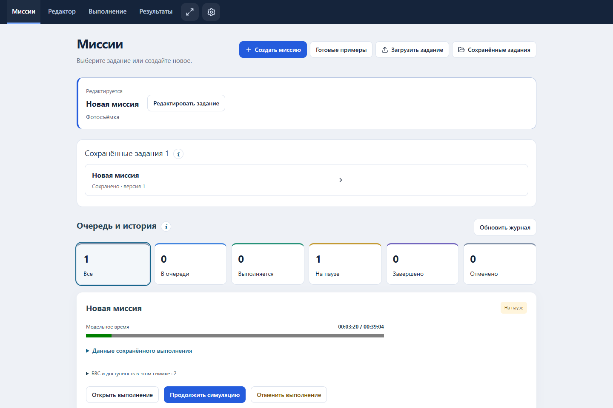

# Интерфейс планировщика: краткое руководство

Обновление: 20 сентября 2026. Адрес локального стенда: http://127.0.0.1:3016/planner.

Последнее уточнение: [подсказки по запросу, цвета действий и отдельные журналы](help-actions-execution-2026-09-20.md). Во «Выполнении» появились карточки миссий; примеры проходят расчёт и подтверждение перед запуском. Просмотр журнала другой миссии не останавливает текущую симуляцию.

## Где что находится

| Раздел | Для чего |
| --- | --- |
| Миссии | Новое задание, готовые примеры, загрузка файла, сохранённые задания, очередь и история |
| Редактор | Работы, участки, время, парк БВС, ограничения, качество и расчёт вариантов |
| Выполнение | Наблюдение за модельным полётом: карта, выбор аппарата, запуск, пауза, заряд и высота |
| Результаты | Проверки и файлы задания, маршрутов и доказательств |
| Шестерёнка | Светлая, тёмная или системная тема; справка с иллюстрациями и словарём |
| «…» у названия миссии | Описание именно этой миссии, редактирование, сохранение, копия и экспорт входа |

## Рабочий путь

1. Открыть пример, загрузить JSON/YAML или создать миссию. Новый документ начинается с явно учебного участка и парка. Предпросмотр не запускает расчёт.
2. В редакторе выбрать один или несколько видов работ. Каждый тип добавляется независимо; прежние работы, их области, профили и назначения сохраняются. Поддерживаются до 8 работ, в том числе несколько одного типа.
3. В «Территория» выбрать нужную работу и нарисовать/импортировать её область. Новому типу копируется текущая область, но дальнейшие правки разных работ не синхронизируются. Esc отменяет только черновик рисования. Кнопка прицела возвращает общий масштаб.
4. Уточнить «Срок», «Парк БВС», «Ограничения» и «Приоритет». Для каждого выбранного вида работ нужен совместимый аппарат с нужным сенсором. Автовыбор не создаёт несуществующее оборудование.
5. При необходимости загрузить погоду для территории и времени. Просмотр прогноза и применение к заданию — отдельные действия. Обновление не меняет подтверждённый план автоматически.
6. Нажать «Рассчитать варианты». Сравнить завершение, суммарный налёт и проверки. Подробные показатели каждой карточки раскрываются отдельно. Если варианты совпали, система сообщает об этом, не выдумывая ещё один маршрут.
7. Прочитать допущения, подтвердить допустимый план, открыть «Выполнение» и начать симуляцию. БВС подписаны на карте; выбор метки или карточки выделяет аппарат. При ожидании указан следующий взлёт. Пауза останавливает движение и сохраняет модельное время.
8. В «Результаты» выгрузить вход, план и доказательства. Изменение задания отменяет прежнее подтверждение и требует нового расчёта. Копия сохраняется под новым ID, не перезаписывая исходную запись.

## Несколько работ и редактирование

- Флажки в «Работы» независимы: RGB, MS, ИК, LiDAR и геофизика могут присутствовать вместе.
- Снятие типа запрашивает подтверждение удаления его работ и участков. Последнюю работу удалить нельзя.
- «Участки и названия работ» позволяет переименовать конкретную работу, добавить ещё один участок такого же типа или удалить только выбранную работу.
- При нескольких работах редактор явно показывает, к какой работе относятся локальные настройки. Парк, окно миссии и общие правила остаются общими.
- После импорта редактор начинает с раздела «Работы». Кнопка «Редактировать задание» доступна на карточке текущего задания и в меню миссии.

## Как читать выполнение

Метка с символом аппарата — расчётное положение БВС. Цвет совпадает с его карточкой и маршрутом. Стрелка показывает направление движения. Пульсация появляется только при запущенной симуляции и нахождении в воздухе; пауза её останавливает.

Модель аппарата и короткий номер показаны вместе. Для пользовательского профиля без подтверждённой марки указывается «Свой профиль БВС», а не выдуманное название производителя. Полные данные находятся в парке и сведениях об аппарате. Исходные ID и названия файлов не меняются. Если аппарат не участвует в плане, выполнение выбирает участвующий БВС, а не показывает пустые приборы неназначенного аппарата.

Видимые показатели выбранного аппарата: фаза, высота в локальном уровне, прогноз заряда и путевая скорость. Подробные координаты, события и расписание скрыты в раскрываемых блоках. Большая длительность миссии больше не выводится под картой выполнения отдельным табло.

## Словарь

| Термин | Понятное объяснение |
| --- | --- |
| Миссия | Всё задание, включая работы, участки, ресурсы, время и правила |
| Работа | Один вид съёмки/измерений на одном участке |
| План | Распределение работ, маршруты и расписание, найденные расчётом |
| Вылет | Один полёт от взлёта до посадки; их может быть несколько на БВС |
| БВС | Беспилотное воздушное судно |
| RGB | Обычные цветные фотографии |
| RGB A/B, центральная/ближняя база | Имена аппаратов, работ или мест старта в примерах; A/B — не разные стандарты RGB |
| MS / ИК / LiDAR | Мультиспектральные каналы / тепловая съёмка / лазерное облако точек |
| АКБ | Аккумуляторная батарея |
| Резерв 25% | После посадки должно остаться не менее 25% полного заряда; не запас для расходования на съёмку |
| Заряд | В стенде — расчёт, а не измерение реальной батареи |
| Налёт | Сумма времени в воздухе всех БВС; не равно времени всей миссии при параллельных полётах |
| Ветер от 270° | Дует с запада; направление — откуда, не куда |
| Неизвестная проверка | Недостаточно данных или возможностей модели; это не успешно закрытое требование |

## Файлы и ограничения

YAML и JSON задания можно загрузить обратно. MD — описание для чтения. GeoJSON/KML — координатные маршруты. «Доказательства» содержат вход, расчёт, проверки и контрольные суммы, но не реальные бортовые логи.

Сохранённые задания и история находятся только в этом браузере. Для переноса и резервной копии выгружайте файлы. Одна открытая страница ведёт выбранную симуляцию; календарь сам не запускает очередь, закрытая страница не продолжает выполнение. Возобновление использует сохранённую паузу; ползунок — просмотр без переписывания истории.

Реальные БВС не подключены. Подложка карты не является разрешением на полёт и не заменяет рельеф. Прогноз Open-Meteo — внешние прогнозные данные, не бортовая метеостанция. Модель не доказывает пригодность для реальных полётов или физический износ оборудования.

## Иллюстрации

Те же реальные скриншоты учебного стенда доступны внутри справки:

