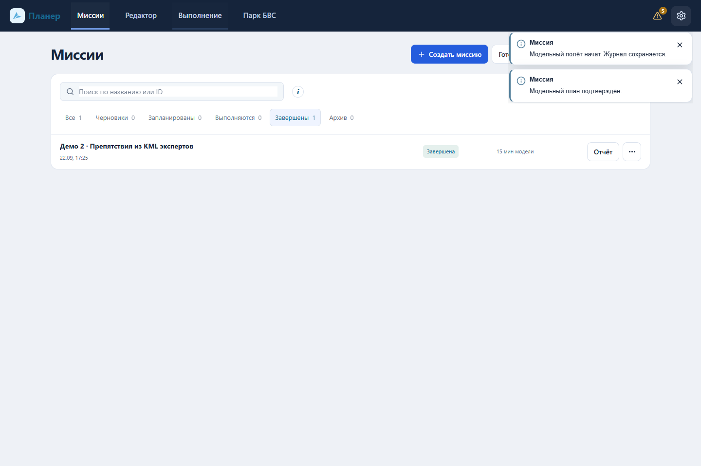
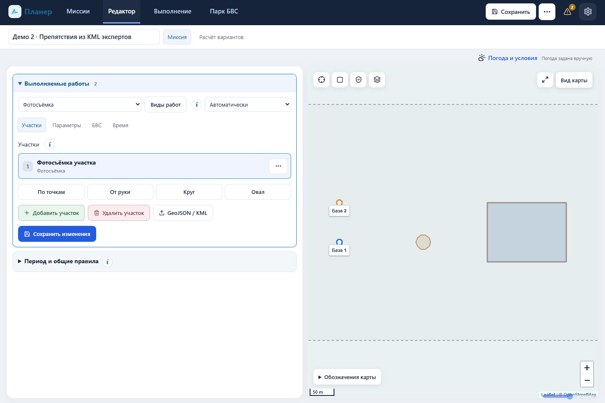
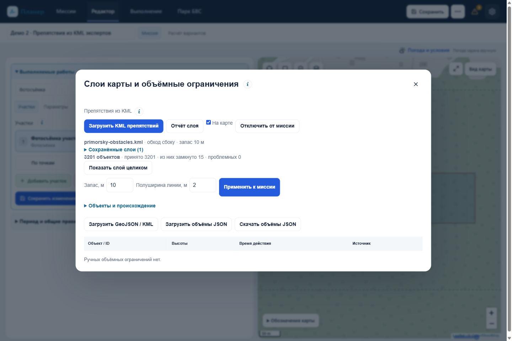
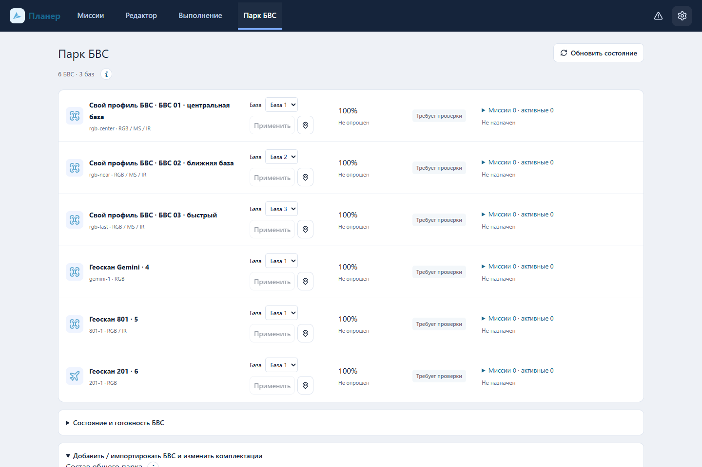
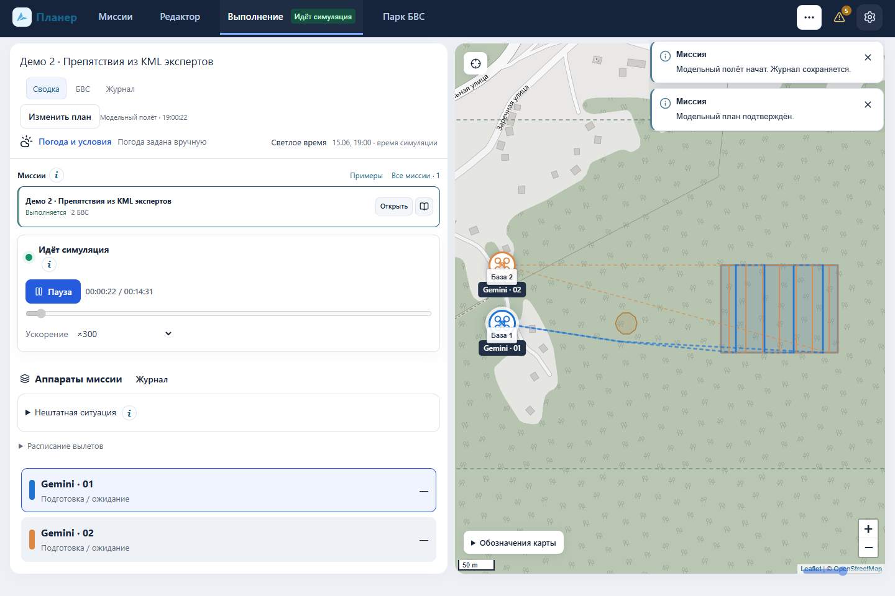
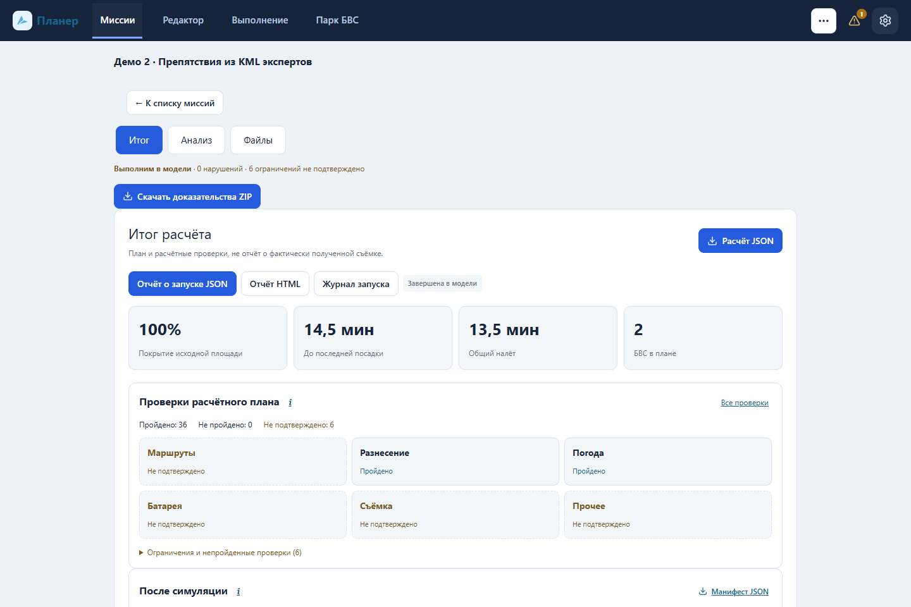

# Инструкция по интерфейсу

Версия комплекта: prime-geoscan-2026.09.22-r3. Снимки сняты 22 сентября в отдельном профиле браузера. В Демо 2 препятствия взяты из KML экспертов, миссия и условия модельные.

## 1. Миссии: поиск и выбор



Одна строка объединяет миссию и её историю запусков. Поиск работает по названию и ID. Счётчики фильтруют черновики, запланированные, выполняемые, завершённые и архивные миссии. Более свежие записи расположены выше.

- **Создать миссию** открывает редактор.
- **Готовые примеры** загружает один из демонстрационных входов.
- **Загрузить миссию** принимает JSON/YAML 2.0 с полным составом, показывает проверку перед заменой.
- **Открыть** загружает документ в редактор; **Наблюдать** открывает выбранный запуск.
- В **⋯** находятся дополнительные действия: копия, переименование, экспорт, архив/восстановление. Черновик без запусков можно удалить после подтверждения.
- Сохранение само по себе не означает постановку в выполнение. Отсчёт очереди не обещает фоновый запуск при закрытом браузере.

Для резервной копии выгрузите документ. Очистка браузера или смена порта может сделать локальные записи недоступными.

## 2. Редактор: работа, участок и параметры



Название миссии редактируется в одной строке. «Период и общие правила» раскрывается по необходимости. «Выполняемые работы» позволяет отметить несколько видов съёмки/измерений.

1. Выберите вид работы, затем нужный участок.
2. **Участки:** добавьте, удалите или измените контур; доступны точки, свободная линия, круг/овал и импорт GeoJSON/KML. Выбранный участок и его вершины можно редактировать. Карта остаётся на месте.
3. **Параметры:** задайте высоту и требования качества этой работы. Это не общая высота всех аппаратов.
4. **БВС:** оставьте автовыбор или ограничьте набор конкретными совместимыми аппаратами. Отметка разрешает использовать аппарат, но не требует обязательно задействовать его.
5. **Время:** задайте собственное окно внутри общего периода, если работа имеет отдельный срок.
6. **Параметры участка:** выберите индивидуальные значения или наследование от другого участка того же вида. Связанные поля редактируются у источника. Геометрия остаётся независимой.

Высотные/временные запреты и препятствия действуют для всей миссии. Импорт контуров не содержит автоматически рельеф и высоту зданий. Их данные должны быть заданы явно.

**Сохранить** сохраняет текущий ID; **Сохранить как / копия** создаёт отдельную миссию. Изменение задания сбрасывает прежнее подтверждение плана.

### Слой препятствий экспертов



На карте откройте **Слои и препятствия → Загрузить KML препятствий**. Это отдельный импорт, не кнопка импорта участков. Выберите оригинальный KML, проверьте сводку, укажите защитный отступ и половину ширины линейного объекта, затем примените. Значения являются допущениями оператора, не автоматически установленной нормой.

Полный каталог хранится отдельно и переносится вместе с миссией. Поиск по имени/ID позволяет сфокусировать карту на объекте. Скрытый слой продолжает учитываться расчётом. Некорректный файл не должен заменять ранее применённый. После изменения слоя рассчитайте и подтвердите новый план. Запущенная миссия сохраняет исходный снимок.

## 3. Расчёт вариантов

В редакторе откройте **Расчёт вариантов**, нажмите **Рассчитать варианты**. Выберите цель и сравните:

| Показатель | Простой смысл |
|---|---|
| Время завершения | Через сколько закончится вся миссия, включая последнюю посадку |
| Суммарный налёт | Сколько времени все аппараты суммарно проведут в полёте |
| Остаток / резерв | Ожидаемый заряд после вылета и минимально допустимый запас |
| Вылеты | Число отдельных полётов, включая повторные |
| БВС | Сколько аппаратов потребуется плану |

«Раньше закончить» может использовать несколько БВС параллельно. «Меньше летать» уменьшает общий налёт, но может закончить позже. «Баланс» показывается, если отличается. Ни один вариант не считается доказанным глобальным оптимумом.

Проверьте причины отказов и неизвестные данные. При нехватке ресурсов откройте рекомендации и проверьте изменение отдельным расчётом. Замена батареи в такой гипотезе не меняет фактический парк.

**Проверить и подтвердить** связывает подтверждение с конкретным входом и планом. Неполный или недопустимый план нельзя подтвердить как успешное выполнение всей миссии.

## 4. Парк БВС



Парк общий для интерфейса, но каждая миссия использует свой снимок. После изменения общего парка примените его к нужной миссии и пересчитайте план.

- Добавление Gemini, 801, 201 или собственного профиля.
- Выбор допустимой установленной комплектации.
- Импорт **prime-fleet JSON**, предпросмотр добавлений/изменений/конфликтов ID и отдельное подтверждение обновления.
- Назначение базы, её названия и координат. База имеет постоянный ID.
- Просмотр заряда и источника последнего состояния.

**Не опрошен** означает отсутствие реальной проверки связи. Кнопка обновления перечитывает локальные модельные/операторские записи, а не вызывает настоящий аппарат. «Подготовка» и «проверка перед повторным вылетом» — заданные наземные интервалы, не измеренные автоматически нормативы.

Паспортный максимум времени полёта не равен гарантированному рабочему ресурсу. Профили явно отделяют эти значения. Произвольная комбинация всех камер не считается физически подтверждённой.

## 5. Выполнение



После подтверждения выберите **Выполнить миссию**. Это запуск модельной симуляции. Масштаб **×1** соответствует реальному течению времени модели; большие множители ускоряют показ.

- Слева: выбранная миссия, управление и разделы **Сводка / БВС / Журнал**.
- Справа: весь маршрут, аппараты и площадки. Ширина панели регулируется ползунком.
- Выбор другой миссии меняет карту и журнал. Два независимых запуска продолжают двигаться отдельно.
- Пауза относится к выбранному запуску. Просмотр/ползунок не переписывает прошлый журнал и не возвращает энергию.
- У каждого аппарата видны модель и ID; на карте подписаны базы.
- Симуляция аварийных событий находится в раскрываемом блоке. Следуйте показанным допустимым действиям, не трактуйте модель как реальную команду борту.

**Изменить план** доступно через безопасную наземную точку. В воздухе требуется сначала завершить проверенную посадку. Новая версия показывает остаток и связь с исходной, затем проходит расчёт и подтверждение заново. Не следует удалять старый запуск ради нового.

## 6. Отчёты и выгрузки



Откройте отчёт из строки миссии или её истории. Выберите нужный запуск, если их несколько. Выгружайте:

- JSON/HTML запуска с журналом и батареями;
- плановый KML/GeoJSON группы или аппарата;
- пакет проверок расчёта;
- **Скачать доказательства ZIP**: самодостаточный пакет выбранного запуска с оригиналом KML, входом, планом, журналом и контрольными суммами;
- ожидаемое покрытие/фотоотпечатки и манифест материалов.

Маршрут в файле — план, журнал — достигнутая часть модельного выполнения. Они не равны реальной записи GNSS. Фотографии не создаются и не копируются; `receivedData=false` обозначает это прямо.

Для JSON запуска:
```powershell
node --experimental-transform-types scripts/verify-mission-run-report.ts path/to/run.report.json
```

Для evidence расчёта:
```powershell
npm run verify:evidence -- path/to/mission.evidence.json output/expert-check.json
```

Для архива запуска:
```powershell
node --experimental-transform-types scripts/verify-mission-archive.ts path/to/mission.evidence.zip
```

## 7. Погода, помощь и уведомления

«Погода и условия» показывает ручной ввод или источник прогнозного снимка. Проверьте район и дату перед применением. Ветер «от 270°» — ветер с запада. Прогноз на поверхности не считается измерением у каждого аппарата на высоте.

Шестерёнка содержит светлую/тёмную/системную тему и справку. Кнопки **i** открывают пояснение соответствующего блока. Уведомления появляются поверх в правом верхнем углу, закрываются крестиком; история доступна по значку уведомлений.

## 8. Если что-то не получилось

| Симптом | Действие |
|---|---|
| Не найден план | Прочитать ограничения/рекомендации; проверить сенсор, заряд, срок, ветер и площадки. Отказ поиска не доказывает абсолютную невозможность |
| Снимок устарел | Восстановить вход отдельной копией, пересчитать и подтвердить. Не обходить повторную проверку |
| Запуск занят/конфликтует | Проверить ID аппаратов и районы; пауза не освобождает пространство |
| Карта без подложки | Проверить доступ к тайлам или включить режим без внешней подложки; собственная геометрия сохраняется |
| После смены порта нет миссий | Загрузить ранее экспортированный JSON/YAML в новый origin |
| Ошибка импорта | Проверить формат, координаты, размер и сообщения схемы. Испорченный файл не должен заменять текущую миссию |

Границы реального применения: [KNOWN-LIMITATIONS](KNOWN-LIMITATIONS.md).
